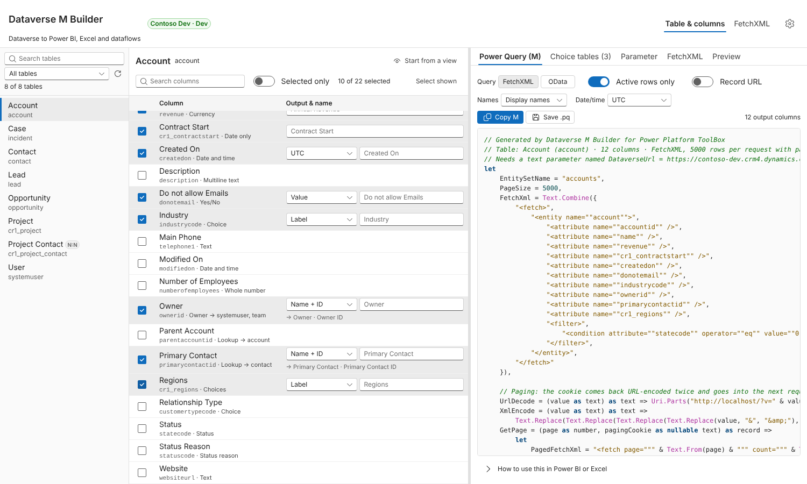
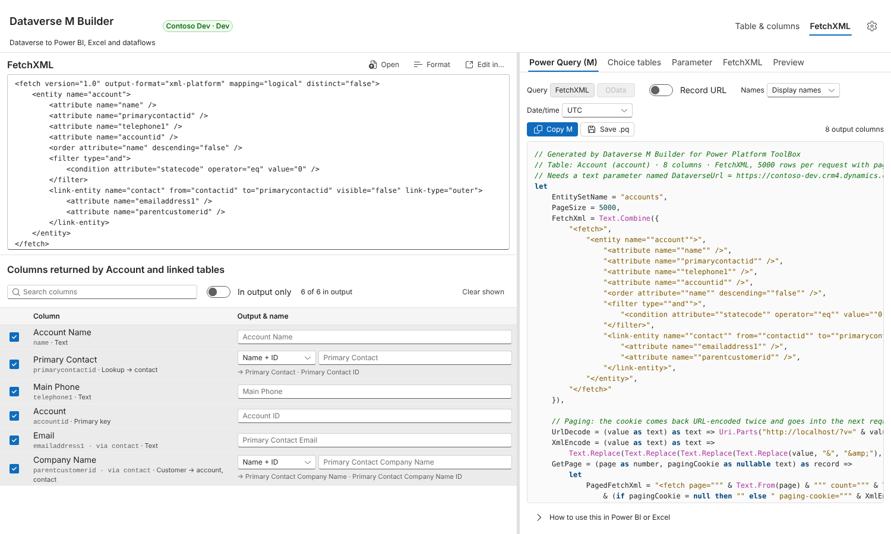

# Dataverse M Builder for Power Platform ToolBox

Generate Power Query (M) scripts that load Dataverse data into Power BI, Excel or dataflows: pick a table and its columns, start from a view, or paste FetchXML with linked tables. The generated queries page through every row, return readable names for lookups and choices, and use a single environment-URL parameter so scheduled refresh in the Power BI service needs only one credential.

A tool for [Power Platform ToolBox](https://www.powerplatformtoolbox.com), inspired by the XrmToolBox plugin _Power Query (M) Builder_. See [Credits](#credits).



## Install

In Power Platform ToolBox (version 1.2.7 or later), open the **Marketplace**, search for _Dataverse M Builder_ and install it. Connect to a Dataverse environment and open the tool.

## What it does

**Two ways to build a query**

- **Table & columns**: search the tables, tick the columns you want, choose how each one comes out, and rename it. _Start from a view_ loads any system or personal view, including its filters and linked tables; type in the search box above the list to find a view by name.
- **FetchXML**: paste or open FetchXML, for example from FetchXML Studio. Linked tables (`link-entity`), column aliases, `all-attributes`, `top` and aggregate queries are all supported. _Edit in…_ sends the query to another installed FetchXML tool and picks up the result when that tool returns one.

**Per-column output**

| Column type                            | Options                                                                   |
| -------------------------------------- | ------------------------------------------------------------------------- |
| Lookup, Customer, Owner                | Name + ID (default), Name, ID, or Name + ID + table                       |
| Choice, Choices, Status, Status reason | Label (default), Value, or Label + value                                  |
| Yes/No                                 | Value (default, true/false), Label, or Label + value                      |
| Date and time (user local)             | UTC (default), local time with daylight saving, or the formatted text     |
| Date only, time-zone independent       | Always returned as a `date`, or a `datetime` without time-zone conversion |
| Currency, numbers, text                | Typed as `Currency.Type`, `Int64.Type`, `type number` or `type text`      |

**Local time** converts with a standard UTC offset plus a daylight saving rule: European summer time, US/Canada daylight saving, or none. The builder starts from your computer's time zone. A user-local column with the _Date only_ format is stored as midnight in the user's time zone, so in UTC it can land on the day before; in local time it comes out as a `date` with the day users see, and the builder warns you when such a column is still in UTC.

You can choose display names (`Primary Contact`, `Primary Contact ID`), logical names (`primarycontactid`, `primarycontactidname`) or schema names for the column names, and override any name. Choice tables are generated as separate _Value / Label_ queries, either live (read from metadata on each refresh) or static (values embedded when you generate them). An optional **Record URL** column links each row back to the record, optionally in a specific model-driven app.

**Output tabs**

- **Power Query (M)**: the query, with _Copy_ and _Save .pq_.
- **Choice tables**: one query per choice, status or yes/no column.
- **Parameter**: the `DataverseUrl` parameter query, with the Web API address.
- **FetchXML**: the normalised FetchXML that is embedded in the M.
- **Preview**: runs the query against the connected environment and shows the first rows exactly as the M will shape them.

**Picks up where you stopped.** The table, the ticked columns, your column names and output choices, and the FetchXML are remembered per environment, so reopening the tool to add a column to an existing query doesn't mean starting over. A query handed over by another tool is never mixed with that.



## How the generated M works

- **One data source, one place to maintain.** The `DataverseUrl` parameter holds the environment's Web API address, for example `https://contoso.crm4.dynamics.com/api/data/v9.2`. Every request is `Web.Contents(DataverseUrl, [RelativePath = "<entity set>", Query = …])`, so moving to another environment or API version means changing one value. Power BI checks that Web API address to offer _Organizational account_ sign-in (the bare environment URL doesn't support it), and because the first argument is the parameter itself, the Power BI service sees a single data source and scheduled refresh works. Record links use the part before `/api/data/`. Turn the parameter off under Settings to embed the URL in each query instead.
- **All rows, not 5,000.** FetchXML queries request pages with `page` and `count`. Each page's `@Microsoft.Dynamics.CRM.fetchxmlpagingcookie` is URL-decoded twice (with `Uri.Parts`, as in Microsoft's documentation) and passed XML-encoded to the next request, so large tables don't hit the 50,000-row limit of simple paging. Queries with `top`, and aggregate queries, are sent as one request.
- **Warnings where Dataverse has limits.** The builder tells you when a query sorts on a linked table's column (Dataverse may then page without a cookie, which stops at 50,000 rows) and when a distinct query has no `<order>`.
- **OData alternative.** For a single table you can switch to an OData `$select` query that follows `@odata.nextLink`.
- **Readable values.** Formatted values (lookup names, choice labels) come from the `OData.Community.Display.V1.FormattedValue` annotation, requested with a `Prefer` header only when a column needs it.
- **Stable columns.** Dataverse leaves empty values out of FetchXML results, so the query builds the table with an explicit column list (`MissingField.UseNull`). Every column therefore exists even when a page has no values for it.

## Using a query in Power BI

1. Create a text parameter named `DataverseUrl` with your environment's Web API address, such as `https://contoso.crm4.dynamics.com/api/data/v9.2`, without a trailing slash (Manage Parameters → New). Or paste the _Parameter_ tab into a blank query with that name.
2. Get data → Blank query → Advanced Editor, paste the M, click Done.
3. When Power BI asks for credentials for `https://<org>.crm….dynamics.com/api/data/v9.2`, choose **Organizational account** and sign in. In the Power BI service, set the same OAuth2 credential on the data source; if the connection test fails, tick _Skip test connection_.

## Working with other tools

The tool declares the `fetchxml` capability in `pptb.config.json`, so FetchXML Studio's _Send to_ menu, and any other tool, can open it with a query:

```ts
const result = await toolboxAPI.invocation.launchTool(
  "@jybk/pptb-dataverse-m-builder",
  {
    fetchXml,
  },
);
// result: { mQuery: string, fetchXml: string } when the user clicks "Send back to caller"
```

The tool also accepts `{ entityName: "account" }` to open a table directly.

## What this tool changes

Nothing in Dataverse. It reads table metadata and views, and fetches sample rows only when you click _Preview_, up to the number of rows you pick. It never creates, updates or deletes records or customisations. ToolBox keeps your settings and your last query per environment on your own computer, and files are written only where you choose to save them.

## Notes and limits

- The FetchXML travels in the request URL. Very large queries (tens of kilobytes of FetchXML) can exceed the Web API's URL length limit.
- _Fixed offset_ applies one UTC offset all year and ignores daylight saving. Use UTC and convert in your model if you need exact local times.
- Dataverse may not return a paging cookie for some queries, such as those ordered by a linked table's column. The query then falls back to simple paging, which is limited to 50,000 rows.
- The OData style is only offered for a single table without joins or aggregates.

## Development

To build or test the tool, load it locally, host it in a private marketplace or publish a fork, see [CONTRIBUTING.md](https://github.com/jybk/pptb-dataverse-m-builder/blob/main/CONTRIBUTING.md).

## Credits

The idea and workflow come from **Power Query (M) Builder**, the XrmToolBox plugin by Mohamed Rasheed and Ulrik "CRM Chart Guy" Carlsson ([XrmToolBox listing](https://www.xrmtoolbox.com/plugins/PowerQueryBuilder/), [project page](https://crmchartguy.com/power-query-builder/)). That plugin has no published licence. Dataverse M Builder is an independent reimplementation: it contains none of the plugin's code, name, icon or screenshots. Its authors aren't affiliated with this tool and haven't endorsed it.

## AI assistance

Most of this tool's code was written with Claude, Anthropic's AI assistant. Jay tested it against a live Dataverse environment and maintains it. Please report problems through [GitHub issues](https://github.com/jybk/pptb-dataverse-m-builder/issues).

## License

MIT
