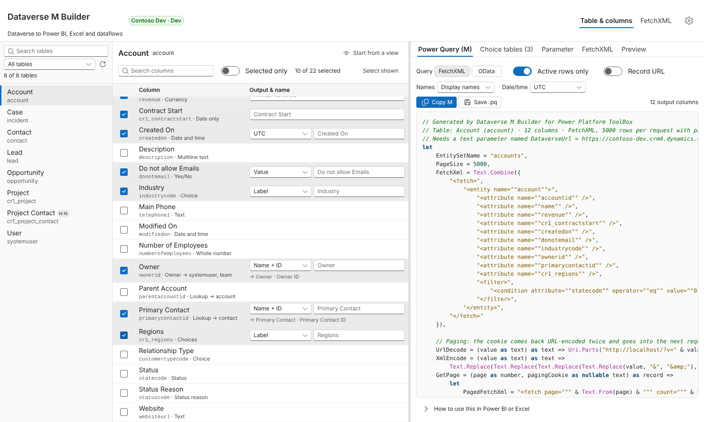
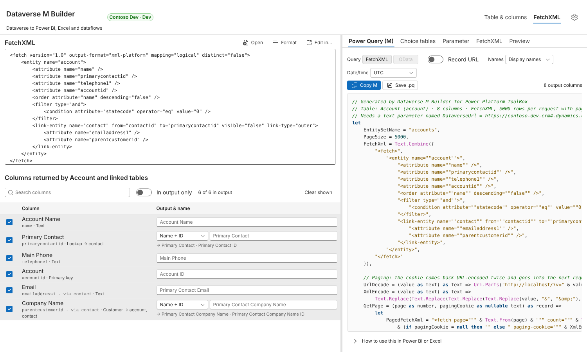

# Dataverse M Builder for Power Platform ToolBox

Generate Power Query (M) scripts that load Dataverse data into Power BI, Excel or dataflows: pick a table and its columns, start from a view, or paste FetchXML with linked tables. The generated queries page through every row, return readable names for lookups and choices, and use a single environment-URL parameter so scheduled refresh in the Power BI service needs only one credential.

A tool for [Power Platform ToolBox](https://www.powerplatformtoolbox.com), inspired by the XrmToolBox plugin _Power Query (M) Builder_. See [Credits](#credits).



## Install

In Power Platform ToolBox (version 1.2.7 or later), open the **Marketplace**, search for _Dataverse M Builder_ and install it. Connect to a Dataverse environment and open the tool.

## What it does

**Two ways to build a query**

- **Table & columns**: search the tables, tick the columns you want, choose how each one comes out, and rename it. The checkbox at the top of the column list selects or clears every column the list shows, so after a search it only touches the matches. _Start from a view_ loads any system or personal view, including its filters and linked tables; type in the search box above the list to find a view by name.
- **FetchXML**: paste or open FetchXML, for example from FetchXML Studio. Linked tables (`link-entity`), column aliases, `all-attributes`, `top` and aggregate queries are all supported. The editor folds away once a query is loaded (click _FetchXML_ to open it), and the column list shows which view you started from. Untick a column to take it out of the generated query. Switch on _Other columns_ to also list the columns the query doesn't have yet, of the main table and of each linked table that returns columns, and tick one to add it; your FetchXML stays as you wrote it, and the generated query includes the column. Aggregate queries can't take more columns, since they would change the grouping. _Edit in…_ sends the query to another installed FetchXML tool and picks up the result when that tool returns one.

**Per-column output**

| Column type                            | Options                                                                   |
| -------------------------------------- | ------------------------------------------------------------------------- |
| Lookup, Customer, Owner                | Name + ID (default), Name, ID, or Name + ID + table                       |
| Choice, Choices, Status, Status reason | Label (default), Value, or Label + value                                  |
| Yes/No                                 | Value (default, true/false), Label, or Label + value                      |
| Date and time (user local)             | UTC (default), local time with daylight saving, or the formatted text     |
| Date only, time-zone independent       | Always returned as a `date`, or a `datetime` without time-zone conversion |
| Currency, numbers, text                | Typed as `Currency.Type`, `Int64.Type`, `type number` or `type text`      |

**Local time** converts with a standard UTC offset plus a daylight saving rule: European summer time, US/Canada daylight saving, or none. The builder starts from your computer's time zone. A user-local column with the _Date only_ format is stored as midnight in the user's time zone, so in UTC it can land on the day before; in local time it comes out as a `date` with the day users see, and the builder warns you when such a column is still in UTC.

You can choose display names (`Primary Contact`, `Primary Contact ID`), logical names (`primarycontactid`, `primarycontactidname`) or schema names for the column names, and override any name. Choice tables are generated as separate _Value / Label_ queries, either live (read from metadata on each refresh) or static (values embedded when you generate them). An optional **Record URL** column links each row back to the record, optionally in a specific model-driven app.

**Output tabs**

- **Power Query (M)**: the query, with _Copy_ and _Save .pq_.
- **Model**: the tables that go with the main query, and the relationships between them:
  - a choice table (_Value / Label_) per choice, status, yes/no or multi-select column;
  - a bridge table per multi-select column of the main table, with one row per record and selected choice, so you can filter and count by each choice;
  - a lookup table per table the lookup columns point to, with its key and primary name. _Columns…_ adds more of that table's columns, chosen and shaped like the main query's. Owner (users and teams) and Customer (accounts and contacts) are one table each, with a type column;
  - the relationships, as a list and as a TMDL script you paste into Power BI Desktop's _TMDL view_ to create them all at once. Applying the script again replaces those relationships instead of adding copies.
- **Parameter**: the `DataverseUrl` parameter query, with the Web API address.
- **FetchXML**: the normalised FetchXML that is embedded in the M.
- **Preview**: runs the query against the connected environment and shows the first rows exactly as the M will shape them.

**Picks up where you stopped.** The table, the ticked columns, your column names and output choices, and the FetchXML are remembered per environment, so reopening the tool to add a column to an existing query doesn't mean starting over. A query handed over by another tool is never mixed with that.



**Export**

- **Power BI project (.pbip)**, on the _Model_ tab: the main query and every query that goes with it as tables, with their columns and types, the `DataverseUrl` parameter and the relationships, plus an empty report page. Open the .pbip in Power BI Desktop and refresh; there's nothing to paste or apply.
- **Power BI template (.pbit)**, on the _Model_ tab: the same model in the format every Power BI Desktop opens, the Report Server edition included, without preview features. It asks for the `DataverseUrl` when you open it, then loads the data.
- **Excel workbook (.xlsx)**, on the _Power Query (M)_ and _Model_ tabs: the main query, loaded to a table and refreshed when the workbook opens.

## How the generated M works

- **One data source, one place to maintain.** The `DataverseUrl` parameter holds the environment's Web API address, for example `https://contoso.crm4.dynamics.com/api/data/v9.2`. Every request is `Web.Contents(DataverseUrl, [RelativePath = "<entity set>", Query = …])`, so moving to another environment or API version means changing one value. Power BI checks that Web API address to offer _Organizational account_ sign-in (the bare environment URL doesn't support it), and because the first argument is the parameter itself, the Power BI service sees a single data source and scheduled refresh works. Record links use the part before `/api/data/`. Turn the parameter off under Settings to embed the URL in each query instead.
- **All rows, not 5,000.** FetchXML queries request pages with `page` and `count`. Each page's `@Microsoft.Dynamics.CRM.fetchxmlpagingcookie` is URL-decoded twice (with `Uri.Parts`, as in Microsoft's documentation) and passed XML-encoded to the next request, so large tables don't hit the 50,000-row limit of simple paging. Queries with `top`, and aggregate queries, are sent as one request.
- **Warnings where Dataverse has limits.** The builder tells you when a query sorts on a linked table's column (Dataverse may then page without a cookie, which stops at 50,000 rows) and when a distinct query has no `<order>`.
- **OData alternative.** For a single table you can switch to an OData `$select` query that follows `@odata.nextLink`.
- **Readable values.** Formatted values (lookup names, choice labels) come from the `OData.Community.Display.V1.FormattedValue` annotation, requested with a `Prefer` header only when a column needs it.
- **Stable columns.** Dataverse leaves empty values out of FetchXML results, so the query builds the table with an explicit column list (`MissingField.UseNull`). Every column therefore exists even when a page has no values for it.

## Using a query in Power BI

### As a Power BI project

1. On the _Model_ tab, check the main query's name and the notes, then choose **Save Power BI project…** and pick a folder. The tool makes a new folder in it, named after the main query (with "(2)" added if that name is taken), so nothing there is overwritten.
2. Before opening it the first time, turn on two preview features in Power BI Desktop (File → Options and settings → Options → Preview features): **Power BI Project (.pbip) save option** and **Store semantic model using TMDL format**, then restart Power BI Desktop. Without them, Power BI Desktop opens an empty report instead of the project, without saying why. The Report Server edition of Power BI Desktop has no preview features; use the template there.
3. Open the `.pbip` file in that folder with Power BI Desktop.
4. The model opens without data. Choose **Refresh**, and when asked for credentials choose **Organizational account** and sign in.

From there, save it as a .pbix (File → Save as) if you'd rather have one file, or keep the project folder in Git: exporting the same query again gives the same files, so a diff shows only what changed.

### As a Power BI template

1. On the _Model_ tab, choose **Save Power BI template…**.
2. Open the `.pbit` file in Power BI Desktop, any edition. It asks for `DataverseUrl`, filled in with the environment you exported from; change it to load another environment with the same tables.
3. Choose **Load**, and when asked for credentials choose **Organizational account** and sign in. Power BI Desktop creates a new report with the data; save it as a .pbix, or from the Report Server edition, to Power BI Report Server.

### In Excel

Choose **Save .xlsx** on the _Power Query (M)_ tab (or **Save Excel workbook…** on the _Model_ tab) and open the file. If Excel asks, enable editing and content; it refreshes the query when the workbook opens. Choose **Organizational account** when asked to sign in. The workbook holds the main query only, with the URL written into it.

### By hand

For the main query on its own:

1. Create a text parameter named `DataverseUrl` with your environment's Web API address, such as `https://contoso.crm4.dynamics.com/api/data/v9.2`, without a trailing slash (Manage Parameters → New). Or paste the _Parameter_ tab into a blank query with that name.
2. Get data → Blank query → Advanced Editor, paste the M, click Done.
3. When Power BI asks for credentials for `https://<org>.crm….dynamics.com/api/data/v9.2`, choose **Organizational account** and sign in. In the Power BI service, set the same OAuth2 credential on the data source; if the connection test fails, tick _Skip test connection_.

With its choice tables, bridges, lookup tables and relationships, in a Power BI file of your own:

1. Open the _Model_ tab and check the main query's name: the relationships refer to it. Notes there tell you when a column needs its value, its ID or the primary key in the main query to be related, with a button that makes the change.
2. Add the main query with that name, and each query from the Model tab with the name it suggests.
3. Before loading, untick **Autodetect new relationships after data is loaded** (File → Options and settings → Options → Current file → Data Load). Power BI otherwise may relate columns that only share a name, such as two choice tables' _Value_ columns. The bridge and lookup tables' columns carry their table's name (_Owner key_, _Owner name_), so they don't match anything by accident.
4. Choose **Close & Apply**, so all tables are loaded.
5. Open **TMDL view**, paste the relationship script in a tab and click **Apply**.

A multi-select column's bridge relates to the main query in both directions, so picking a choice in its choice table filters the main table. Its request asks only for the primary key and that column, under the main query's filters; if you change the main query's filters later, generate the bridge again. Yes/no columns aren't related, since their label in the main query is enough.

Lookup tables read every row of their table through OData, active or not, so each record finds its match; for a large table (all contacts, say) that is a sizeable load, even with only two columns. Lookups that point to the same tables share one lookup table: _Created By_ and _Modified By_ both relate to _User_, the first through an active relationship and the second through an inactive one, which a measure uses with `USERELATIONSHIP`. A lookup to the main table itself, such as _Parent Account_, gets a table of its own, named after the column. Lookups with more than three target tables, such as _Regarding_, get none. Switch lookup tables off on the Model tab if you only want the choice tables.

A lookup table of one table can have more columns than key and name: open it on the Model tab and choose **Columns…**. The same column list as the main query opens for that table: tick a column to add it, choose how it comes out (a lookup's name, ID or both, a choice's label or value, a date's time zone) and rename it. Key and name are always there, under the lookup table's own names. Every added column is read for every row of the table, so add what reports need. Combined lookup tables (Owner, Customer) keep key, name and type. The choice is remembered per query, and the Power BI project and template include the added columns.

## Working with other tools

The tool declares the `fetchxml` capability in `pptb.config.json`, so FetchXML Studio's _Send to_ menu, and any other tool, can open it with a query:

```ts
const result = await toolboxAPI.invocation.launchTool(
  "@jybk/pptb-dataverse-m-builder",
  {
    fetchXml,
  },
);
// result: { mQuery: string, fetchXml: string } when the user clicks "Send back to caller"
```

The tool also accepts `{ entityName: "account" }` to open a table directly.

## What this tool changes

Nothing in Dataverse. It reads table metadata and views, and fetches sample rows only when you click _Preview_, up to the number of rows you pick. It never creates, updates or deletes records or customisations. ToolBox keeps your settings and your last query per environment on your own computer, and files are written only where you choose to save them.

## Notes and limits

- The FetchXML travels in the request URL. Very large queries (tens of kilobytes of FetchXML) can exceed the Web API's URL length limit.
- _Local time_ knows two daylight saving calendars: European summer time and US/Canada. For other regions it applies the standard offset all year, so use UTC and convert in your model if you need exact local times there.
- Dataverse may not return a paging cookie for some queries, such as those ordered by a linked table's column. The query then falls back to simple paging, which is limited to 50,000 rows.
- The OData style is only offered for a single table without joins or aggregates.
- The Power BI project's and template's report is an empty page, and the model has no measures; both are yours to add.
- Microsoft documents the project format, but not the inside of a template. The template follows what Power BI Desktop itself writes (the February 2025 release, which later releases open too), and has been tested with Power BI Desktop 2.150.1926.0 (January 2026): it opens, asks for the URL and loads every table. If a release of Power BI Desktop won't open one, please [open an issue](https://github.com/jybk/pptb-dataverse-m-builder/issues) with its message. The Excel workbook has the main query only: for the related tables, use the project.
- The generated queries use `Web.Contents`, so steps you add after them in Power Query don't fold back to Dataverse. The filters inside the FetchXML or `$filter` still run on the server. You can replace the source with `OData.Feed` to get folding, but keep these trade-offs in mind:
  - **Labels**: by default, lookups come back as GUIDs and choices as numbers. Expand a lookup's navigation column to get its name (this folds to `$expand`). For choice labels, join the generated choice tables in your model, or add the option `IncludeAnnotations = "OData.Community.Display.V1.FormattedValue"`; the label then sits in each value's metadata, and you need a custom column per field with `Value.Metadata` to bring it out.
  - **Speed**: `OData.Feed` first reads the environment's whole `$metadata` document, which is large in Dataverse, so the first load and every refresh can be slow.
  - **Linked tables and relative dates**: conditions on linked tables and FetchXML operators such as `next-x-months` or `last-x-years` have to be rewritten as Power Query steps, and whether those steps fold varies.

## Development

To build or test the tool, load it locally, host it in a private marketplace or publish a fork, see [CONTRIBUTING.md](https://github.com/jybk/pptb-dataverse-m-builder/blob/main/CONTRIBUTING.md).

## Credits

The idea and workflow come from **Power Query (M) Builder**, the XrmToolBox plugin by Mohamed Rasheed and Ulrik "CRM Chart Guy" Carlsson ([XrmToolBox listing](https://www.xrmtoolbox.com/plugins/PowerQueryBuilder/), [project page](https://crmchartguy.com/power-query-builder/)). That plugin has no published licence. Dataverse M Builder is an independent reimplementation: it contains none of the plugin's code, name, icon or screenshots. Its authors aren't affiliated with this tool and haven't endorsed it.

## AI assistance

Most of this tool's code was written with Claude, Anthropic's AI assistant. Jay tested it against a live Dataverse environment and maintains it. Please report problems through [GitHub issues](https://github.com/jybk/pptb-dataverse-m-builder/issues).

## License

MIT
